# Sharu Nethra R

### **AI/ML Engineer | Full-Stack Developer | Trustworthy AI & FinTech Research**

  
  
  
  

## 🌿 About Me

Hello! I am a Computer Science undergraduate at **SRM Institute of Science and Technology, Kattankulathur**, pursuing an **Honours Track in Financial Technologies (FinTech)** with a cumulative CGPA of **9.24 / 10** (2024–2028).

My engineering focus centers on bridging **trustworthy machine learning** with resilient **full-stack and backend software architectures**:

- 🧠 **AI/ML & Local Retrieval Systems**: I build Retrieval-Augmented Generation (RAG) pipelines, semantic embeddings, and local language model workflows that prioritize data privacy, deterministic retrieval, and hallucination reduction.
- ⚙️ **Backend & Distributed Systems**: I design scalable relational database schemas, multi-tenant resource isolation mechanisms, strict authentication flows, and clean RESTful APIs.
- 💡 **FinTech & Impact-Driven Research**: I am deeply interested in trustworthy AI evaluation, financial inclusion architectures, and computational modeling for climate-related financial resilience.

I believe in measurable engineering: writing clean code, validating functionality with rigorous automated tests, and building software that solves concrete problems with high reliability.

  

## 🚀 Featured Projects

<table>
  <!-- PROJECT 1: LLAMA ASSISTANT -->
  <tr>
    <td width="100%" bgcolor="#FDFBF9" style="border: 2px solid #FFCCE1; border-radius: 12px; padding: 18px;">
      

        
        
         
        <h3 style="margin-top: 8px; margin-bottom: 6px; color: #1E293B;">
          🦙 <a href="https://github.com/Sharunethra/llama-assistant-rag" style="color: #1E293B; text-decoration: none;"><b>Llama Assistant — Local RAG-Based AI Document Assistant</b></a>
        </h3>
        

          A full-stack, privacy-preserving document intelligence assistant that pairs localized Retrieval-Augmented Generation (RAG) with local language model inference to query personal documents without external API token leakage.
        

        

          <b>System Architecture &amp; Pipeline:</b>
        

        <ul style="color: #475569; font-size: 13px; line-height: 1.5; margin-top: 0; margin-bottom: 12px;">
          <li><b>Document Ingestion &amp; Chunking:</b> Ingests multi-page PDF and TXT files, performing automated text extraction and deterministic chunking into 400-word passages with a 50-word sliding-window overlap to preserve syntactic boundaries.</li>
          <li><b>Dense Semantic Embeddings:</b> Encodes passages into 384-dimensional vector embeddings utilizing FastEmbed for lightweight, local vector transformation.</li>
          <li><b>Similarity Retrieval:</b> Computes cosine similarity over stored document vectors to isolate the top-four most relevant passages per user query.</li>
          <li><b>Document-Grounded Inference:</b> Feeds retrieved context into a locally executing Llama 3.2 3B model managed via Ollama, synthesizing precise, citation-grounded answers.</li>
          <li><b>Full-Stack Integration:</b> Token-authenticated Django REST Framework backend with PostgreSQL persistent multi-turn chat history, paired with a responsive React and Vite interface.</li>
        </ul>
        

          
          
          
          
          
          
          
        

        

          🔗 <b>Repository:</b> <a href="https://github.com/Sharunethra/llama-assistant-rag">github.com/Sharunethra/llama-assistant-rag</a> &nbsp;|&nbsp;
          🌐 <b>Live Demo:</b> <a href="https://llama-assistant-rag-1.onrender.com/">llama-assistant-rag-1.onrender.com</a>
        

      

    </td>
  </tr>

  <!-- PROJECT 2: PROMANAGE -->
  <tr>
    <td width="100%" bgcolor="#FDFBF9" style="border: 2px solid #C6E2E7; border-radius: 12px; padding: 18px;">
      

        
        
         
        <h3 style="margin-top: 8px; margin-bottom: 6px; color: #1E293B;">
          📋 <a href="https://github.com/Sharunethra/project-management-system" style="color: #1E293B; text-decoration: none;"><b>ProManage — Unified Project Management System (Web + Mobile)</b></a>
        </h3>
        

          A full-stack, multi-client project and task management system built upon a single unified REST backend and shared relational database, powering a responsive React web client alongside an Android mobile application.
        

        

          <b>Technical Architecture &amp; Implementation:</b>
        

        <ul style="color: #475569; font-size: 13px; line-height: 1.5; margin-top: 0; margin-bottom: 12px;">
          <li><b>Unified REST Backend:</b> Engineered with Node.js, Express, and TypeScript, backed by Prisma ORM and PostgreSQL to serve both Web and mobile clients from a single authoritative source.</li>
          <li><b>Multi-Tenant Resource Ownership:</b> Enforces strict user isolation across all project and task CRUD operations, rejecting cross-tenant unauthorized reads, mutations, or deletions.</li>
          <li><b>Enterprise Security &amp; Auth:</b> Implements bcrypt password hashing (10 salt rounds), JWT authentication, strict Zod schema validation, and API rate limiting on authentication routes.</li>
          <li><b>Mobile Architecture &amp; Offline Resilience:</b> Cross-platform Android client built with React Native and Expo, utilizing Expo SecureStore for encrypted hardware-backed token persistence, graceful offline notifications, and session expiry recovery.</li>
          <li><b>Query Optimization &amp; Dashboards:</b> Database-backed pagination on list endpoints, multi-field search and status/priority filtering, and user-scoped real-time metric aggregates.</li>
          <li><b>Automated Test Suite:</b> Backed by <b>31/31 passing automated unit and integration tests</b> via Jest and Supertest, including end-to-end cross-platform synchronization verification (Tests A through F).</li>
        </ul>
        

          
          
          
          
          
          
          
          
        </ul>
        

          🔗 <b>Repository:</b> <a href="https://github.com/Sharunethra/project-management-system">github.com/Sharunethra/project-management-system</a> &nbsp;|&nbsp;
          ⚙️ <i>Contains complete deployment configurations for Render, Vercel, and Expo EAS</i>
        

      

    </td>
  </tr>

  <!-- PROJECT 3: IMDB SENTIMENT CLASSIFICATION -->
  <tr>
    <td width="100%" bgcolor="#FDFBF9" style="border: 2px solid #CDE5D9; border-radius: 12px; padding: 14px 18px;">
      

        
        <a href="https://img.shields.io/badge/Accuracy-%3E85%25_Test-F2EBCC?style=flat-square&labelColor=F2F1ED&color=F2EBCC">85% Accuracy" /></a>
         
        <h3 style="margin-top: 8px; margin-bottom: 6px; color: #1E293B;">
          🎬 <a href="https://github.com/Sharunethra/TextClassificationWithTensorflow" style="color: #1E293B; text-decoration: none;"><b>IMDB Movie Review Sentiment Classification</b></a>
        </h3>
        

          An NLP deep learning capstone project applying recurrent neural networks to classify large-scale movie reviews into positive and negative sentiment categories.
        

        <ul style="color: #475569; font-size: 13px; line-height: 1.5; margin-top: 0; margin-bottom: 10px;">
          <li><b>Text Preprocessing Pipeline:</b> Performed text cleaning, HTML stripping, stopword handling, tokenization, vocabulary indexing, and sequence padding.</li>
          <li><b>Recurrent Architecture:</b> Built and trained an LSTM (Long Short-Term Memory) neural network using TensorFlow and Keras to capture sequential contextual dependencies.</li>
          <li><b>Evaluation:</b> Evaluated on the Kaggle IMDB dataset, achieving <b>&gt;85% classification accuracy</b> on unseen test data.</li>
        </ul>
        

          
          
          
          
          
          
        

        

          🔗 <b>Repository:</b> <a href="https://github.com/Sharunethra/TextClassificationWithTensorflow">github.com/Sharunethra/TextClassificationWithTensorflow</a>
        

      

    </td>
  </tr>
</table>

  

## 🛠️ Technology Stack

<table width="100%">
  <tr>
    <td width="30%" bgcolor="#FDFBF9" style="border: 1px solid #FFCCE1; padding: 12px; vertical-align: top;">
      <b>💻 Programming Languages</b>
    </td>
    <td width="70%" bgcolor="#FDFBF9" style="border: 1px solid #FFCCE1; padding: 12px;">
      
      
      
      
      
      
    </td>
  </tr>
  <tr>
    <td width="30%" bgcolor="#FDFBF9" style="border: 1px solid #C6E2E7; padding: 12px; vertical-align: top;">
      <b>🤖 AI &amp; Machine Learning</b>
    </td>
    <td width="70%" bgcolor="#FDFBF9" style="border: 1px solid #C6E2E7; padding: 12px;">
      
      
      
      
      
      
    </td>
  </tr>
  <tr>
    <td width="30%" bgcolor="#FDFBF9" style="border: 1px solid #CDE5D9; padding: 12px; vertical-align: top;">
      <b>🌐 Frontend Development</b>
    </td>
    <td width="70%" bgcolor="#FDFBF9" style="border: 1px solid #CDE5D9; padding: 12px;">
      
      
      
      
      
      
    </td>
  </tr>
  <tr>
    <td width="30%" bgcolor="#FDFBF9" style="border: 1px solid #F2EBCC; padding: 12px; vertical-align: top;">
      <b>⚙️ Backend Engineering</b>
    </td>
    <td width="70%" bgcolor="#FDFBF9" style="border: 1px solid #F2EBCC; padding: 12px;">
      
      
      
      
      
      
    </td>
  </tr>
  <tr>
    <td width="30%" bgcolor="#FDFBF9" style="border: 1px solid #F7DDE8; padding: 12px; vertical-align: top;">
      <b>🗄️ Databases &amp; Infrastructure</b>
    </td>
    <td width="70%" bgcolor="#FDFBF9" style="border: 1px solid #F7DDE8; padding: 12px;">
      
      
      
      
      
      
      
    </td>
  </tr>
  <tr>
    <td width="30%" bgcolor="#FDFBF9" style="border: 1px solid #FFCCE1; padding: 12px; vertical-align: top;">
      <b>🛠️ AI Tools &amp; Orchestration</b>
    </td>
    <td width="70%" bgcolor="#FDFBF9" style="border: 1px solid #FFCCE1; padding: 12px;">
      
      
      
    </td>
  </tr>
</table>

  

## 💼 Experience

### 🔹 **Web Developer** — Studique (The Momentum)
*Remote &nbsp;|&nbsp; March 2026 – September 2026*
- Contributed to a live student academic platform serving over 12K+ visitors and 50K+ platform page views.
- Updated syllabus structures and refined the CGPA calculation modules tailored for SRMIST student workflows.
- Maintained academic course material and verified calculation precision across seven or more core student-focused features.

### 🔹 **AI Intern** — Techjays
*Coimbatore, Tamil Nadu &nbsp;|&nbsp; July 2026 – August 2026*
- Engineered a full-stack, local RAG-based AI document assistant powered by Llama 3.2 3B.
- Built backend services in Python and Django REST Framework with PostgreSQL, integrating FastEmbed and Ollama for vector transformations and local language model queries.
- Implemented document ingestion pipelines, overlapping chunking algorithms, dense vector search, and grounded conversational Q&A interfaced through React and Vite.

### 🔹 **AI/ML Intern** — Pirai Infotech Pvt. Ltd.
*Pollachi, Tamil Nadu &nbsp;|&nbsp; June 2026*
- Developed end-to-end machine learning workflows using Python, NumPy, Pandas, Scikit-learn, and TensorFlow.
- Conducted data cleaning, feature extraction, exploratory data analysis (EDA), model training, and comparative evaluation metrics.

### 🔹 **Django & MySQL Intern** — MBT
*Hosur, Tamil Nadu &nbsp;|&nbsp; December 2025*
- Contributed to backend application development using Django and MySQL relational databases.
- Implemented data validation logic and database persistence schemas to support operational workflows.
- Built interactive dashboard visualization components for administrative monitoring.

  

## 🎓 Education

- **SRM Institute of Science and Technology, Kattankulathur**
  - **B.Tech in Computer Science and Engineering**
  - **Honours Track:** Financial Technologies (FinTech)
  - **CGPA:** **9.24 / 10** &nbsp;|&nbsp; *2024 – 2028*
- **CS Academy, Coimbatore**
  - Class XII, CBSE — **87.6%** &nbsp;|&nbsp; *2024*
- **Srinivasa Public School, Udumalpet**
  - Class X, CBSE — **94.2%** &nbsp;|&nbsp; *2022*

  

## 🔬 Research Interests

- **Trustworthy AI & System Evaluation:** Investigating hallucination mitigation, safety guardrails, and deterministic evaluation protocols for large language models.
- **Retrieval-Augmented Generation (RAG):** Contextual chunking methods, dense/hybrid vector index design, and low-latency on-device inference pipelines.
- **Financial Inclusion & FinTech Architectures:** Designing resilient, accessible transaction mechanisms and risk-scoring workflows for underserved economic communities.
- **Climate-Related Financial Resilience:** Computational modeling to quantify environmental and climate risk vectors on consumer finance, credit risk, and institutional resilience.
- **Responsible AI in Practical Software:** Implementing privacy-by-design, cryptographic token security, and strict data isolation across distributed systems.

  

## 📜 Certifications

- **Oracle Certified Professional: Java SE 17 Developer** — *Oracle (Issued July 2026)*
- **NPTEL: Programming in Java** — *Elite Grade*
- **NPTEL: Fundamentals of Object-Oriented Programming** — *Elite Grade*

  

## 🏆 Achievements

- **1st Place — E-SUMMIT ’26 Ideathon**
  - E-Cell, Indian Institute of Information Technology, Design and Manufacturing (IIITDM), Kancheepuram

  

## 📊 GitHub Statistics

  <table border="0" cellspacing="0" cellpadding="0">
    <tr>
      <td align="center" valign="middle">
        
      </td>
      <td align="center" valign="middle">
        
      </td>
    </tr>
  </table>

  

## 📬 Contact & Collaboration

I am always interested in discussing technical research, trustworthy AI, backend system architecture, and impactful engineering opportunities. Feel free to connect:

- 🐙 **GitHub:** [@Sharunethra](https://github.com/Sharunethra)
- 💼 **LinkedIn:** [sharu-nethra-r-18a48b346](https://www.linkedin.com/in/sharu-nethra-r-18a48b346/)
- ✉️ **Email:** [sharunethra18@gmail.com](mailto:sharunethra18@gmail.com)

---

  

    Crafted with care using a custom pastel aesthetic • © 2026 Sharu Nethra R
  

